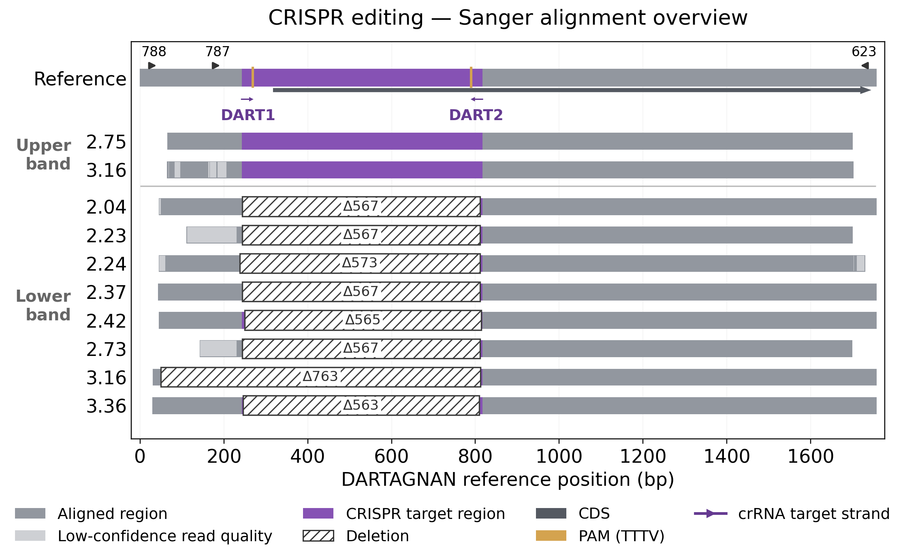

# analyze_edits.py: CRISPR edits from Sanger reads

`analyze_edits.py` aligns Sanger reads (`.ab1` chromatograms or FASTA `.seq` files) to a reference gene, calls the deletions and insertions they carry, and draws every sample under an annotated map of the reference: CDS, primers, CRISPR target sites with their PAM, and crRNA orientation. It also writes per-sample tables, a text report and, for `.ab1` input, a per-read quality-control table and figure.

It was written for screening CRISPR-Cas12a mutants (5' `TTTV` PAM), including samples whose PCR products give two gel bands that were sequenced separately.



*Example on synthetic data: a 60 bp deletion between the two targets (2.75), a 6 bp insertion at cr2 (3.16, upper band), a lighter region where the read was masked (3.16, lower band), and a requested sample with no reads (3.36).*

> **Note:** indel calls are candidates, not validated genotypes. Always check the chromatograms of the reported events. See [Limitations](#limitations).

## Requirements

- Python ≥ 3.8
- [Biopython](https://biopython.org) (a recent version: with very old versions, `N` is scored as a mismatch)
- matplotlib ≥ 3.5 (which brings numpy)

```bash
python3 -m venv crispr
source crispr/bin/activate
pip install biopython matplotlib
```

`run.sh` creates this environment on first use and runs an example analysis.

## Quick start

```bash
python analyze_edits.py \
    --template template.fas \
    --reads chromatograms \
    --ab1 \
    --pam-motif TTTV \
    --out results
```

## Inputs

### Template (`--template`)

One FASTA file. Each record ID ends with a type suffix:

| Suffix | Number | Content |
|---|---|---|
| `\|gene` | exactly 1 | Reference sequence used for all alignments and coordinates |
| `\|cds` | 0 or 1 | Coding sequence. Placed by exact match; otherwise exon blocks are inferred by alignment (check them) |
| `\|primer` | any | Primer, found by exact match on either strand, drawn as an arrow |
| `\|crispr` | any | CRISPR target written as **5' PAM + protospacer** (e.g. `TTTA` + 20–24 nt) |

```text
>GENEX|gene
ATGC...
>GENEX|cds
ATG...TAA
>F1|primer
ACGTACGTACGTACGTACGTAC
>cr1|crispr
TTTACCGATGCTAGCTAGGCTAGCA
```

With `--pam-motif`, the PAM written in the template is not trusted: the protospacer is searched on both strands, and the PAM is read from the reference just 5' of it and checked against the motif. A `|crispr` sequence holding the protospacer alone is accepted too. Sites with a wrong PAM are dropped and reported.

### Reads (`--reads`)

Files or folders (searched recursively). By default `.seq` files (FASTA format) are read; with `--ab1`, `.ab1` chromatograms are read. `*.unclipped.seq` files are ignored.

Reads are grouped into samples by file name:

| File stem | Sample | Band (`--split-bands`) |
|---|---|---|
| `1_17_1_623` | `1_17` | 1 |
| `2_75_2_623` | `2_75` | 2 |
| `2_75_623` | `2_75` | 1 (no band field) |
| `WT_618`, `WT_2_623`, `wild-type_618` | `WT` | both bands |
| anything else | the stem, or `--group-regex` | excluded |

Without `--split-bands`, `--group-regex` (default `^(?P<sample>\d+_\d+)_\d+_\d+$`) sets the sample ID: its `sample` group, or else its first group. Several reads of the same sample are combined in one row.

## How it works

1. **Quality control (`--ab1`).** Read ends are trimmed (`--trim-mode`: sliding-window mean, modified Mott, or none) and the remaining bases below `--min-quality` are masked as `N`. Each read gets a status: `OK`, `FAILED` (usable window < 100 bp), `LOW QUALITY` (mean Q < 30) or `MIXED TRACE` (> 10 % double peaks, which suggests a mixed template).
2. **Alignment.** Each read, and its reverse complement, is aligned locally to the reference with affine gap scores (`--gap-open`, `--gap-extend`); the better strand is kept. `N` scores 0 against any base, so masked stretches are aligned through instead of split by gaps.
3. **Noise filter (`--min-flank`).** Aligned blocks with fewer than `--min-flank` unambiguous bases are dropped, and the gaps around them are merged into one net event. This removes the spurious "deletion + insertion" pairs typical of noisy regions. A short block at the edge of a large deletion is kept when it clearly matches the reference, so the junction stays exact.
4. **Event calling.** Deletions and insertions are read from the gaps between the kept blocks. Events also found in WT reads are flagged (`*` on the figure, `also_in_wt` in the tables) as probable alignment artefacts. Events within 50 bp of a CRISPR target list it in `nearby_crispr`.
5. **Figure.** Grey: aligned region; violet: span between the CRISPR targets (`--highlight`); lighter tone: region weakly supported by unmasked bases (`--conf-window`, `--conf-min-frac`); hatched box `Δn`: deletion; tick `+n`: insertion. Indels smaller than `--min-indel` are not drawn but stay in the tables. Mismatches (SNPs) are counted in the report but never drawn.

## Outputs

Written to `--out` (default `results/`). With `--split-bands`, the per-band files get a `_1` or `_2` suffix.

| File | Content |
|---|---|
| `edit_map.pdf` / `.png` | Figure: reference map plus one row per sample |
| `edit_map_combined.pdf` / `.png` | `--split-bands` only: upper and lower bands in one figure |
| `summary.tsv` | One row per sample: reads, passing reads, covered bp, number of events, status |
| `events.tsv` | One row per distinct event per sample (1-based coordinates; an insertion lies before `start_1based`) |
| `report.txt` | Target, PAM and primer positions; per read: strand, coverage, mismatches, quality; per event: details |
| `qc_reads.tsv` | `--ab1` only: trimming and quality metrics and QC status of every read |
| `qc_reads.pdf` / `.png` | `--ab1` only: Phred class of every base of every read |

Tables and reports always include every sample. `--samples`, `--samples-1/2` and `--hide-samples-1/2` only change which rows are drawn.

## Options

Run `python analyze_edits.py --help` for the full list with defaults. The main ones:

| Option | Default | Effect |
|---|---|---|
| `--ab1` | off | Read `.ab1` chromatograms, with trimming, masking and QC |
| `--min-quality` | 20 | Phred threshold for trimming and masking (0 disables both) |
| `--trim-mode` | `window` | `window`, `mott` or `none` |
| `--pam-motif` | none | IUPAC 5' PAM, e.g. `TTTV`; validates target sites in the reference |
| `--split-bands` | off | Separate gel bands 1 and 2 (third field of the file name) |
| `--gap-open` / `--gap-extend` | −2 / −0.05 | Gap scores. More negative opening (e.g. −10) favours one large deletion over many small gaps |
| `--min-flank` | 20 | Minimum unambiguous bases for an aligned block to be trusted (0 disables) |
| `--min-aligned` | 10 | Minimum aligned bases for a read to be used |
| `--min-indel` | 1 | Smallest indel drawn on the figure |
| `--samples` | all | Samples to draw, in this order (`2.75` and `2_75` are equivalent) |
| `--samples-1`, `--samples-2` | all | Samples to draw in each band |
| `--hide-samples-1`, `--hide-samples-2` | none | Samples to hide in each band |
| `--highlight` | `between` | Violet overlay: `between` targets, `targets` only, or `none` |
| `--font-size`, `--row-height` | 13, 0.44 | Figure layout |
| `--verbose` | off | Print the ambiguous-base profile of every read |

## Example: two gel bands

`run.sh` analyses `.ab1` files in `chromatograms/` against `template.fas`, with the two bands drawn separately and in a combined figure:

```bash
bash run.sh                # results in results/, log in alignment_debug.txt
```

## Limitations

- **5' PAMs only.** The PAM is expected 5' of the protospacer (Cas12a-type). 3' PAMs such as SpCas9 `NGG` are not supported.
- **One read gives one allele.** Heterozygous or mixed edits show up as double peaks (`MIXED TRACE` status), not as two alleles. Use a deconvolution tool (e.g. ICE, TIDE, DECODR) for those samples.
- **Breakpoints in repeats are ambiguous.** Local alignment places an indel at one of several equivalent positions in a repeat or homopolymer.
- **Large deletions need flanks.** A deletion is only seen if the read aligns on both sides of it. Deletions that remove a primer site produce no read at all.
- **FASTA input has no quality scores.** Without `--ab1`, no trimming or masking is done beyond `N` calls already in the file.
- **Grouping relies on file names.** Check `summary.tsv` and the `WARNING` lines in the log to confirm every read went to the expected sample and band.

## License

Add your license here (e.g. MIT).
